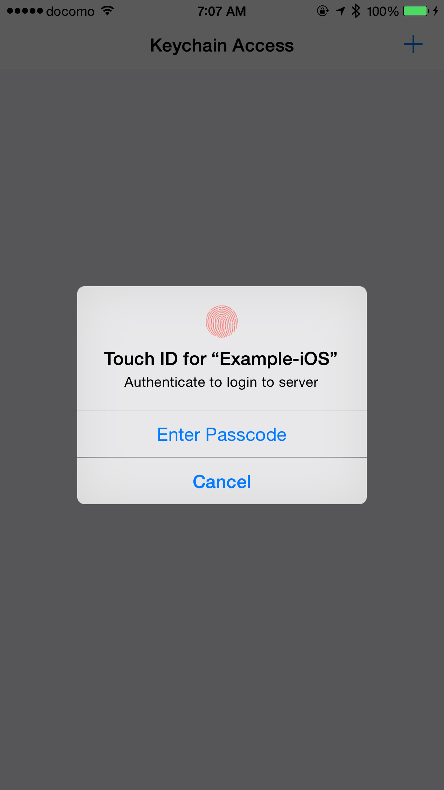
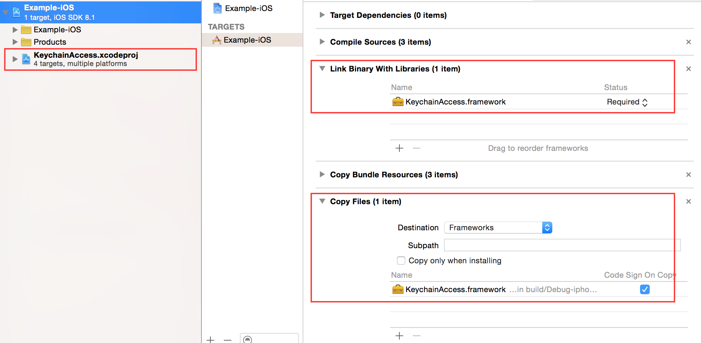

# KeychainAccess

[](https://swift.org/package-manager)

KeychainAccess is a simple Swift wrapper for Keychain that works on iOS and macOS. Makes using Keychain APIs extremely easy and much more palatable to use in Swift.



## :bulb: Features

- Simple interface
- Support access group
- [Support accessibility](#accessibility)
- [Support iCloud sharing](#icloud_sharing)
- **[Support Touch ID / Face ID and Keychain integration](#touch_id_integration)**
- [Works on both iOS & macOS](#requirements)
- [watchOS and tvOS are supported](#requirements)
- **[Mac Catalyst is supported](#requirements)**
- **[Swift 6 compatible](#requirements)**

## :book: Usage

##### :eyes: See also:

- [:link: iOS Example Project](Examples/Example-iOS)

### :key: Basics

#### Saving Application Password

```swift
let keychain = Keychain(service: "com.example.github-token")
keychain["alice"] = "01234567-89ab-cdef-0123-456789abcdef"
```

#### Saving Internet Password

```swift
let keychain = Keychain(server: "https://github.com", protocolType: .https)
keychain["alice"] = "01234567-89ab-cdef-0123-456789abcdef"
```

### :key: Instantiation

#### Create Keychain for Application Password

```swift
let keychain = Keychain(service: "com.example.github-token")
```

```swift
let keychain = Keychain(service: "com.example.github-token", accessGroup: "12ABCD3E4F.shared")
```

#### Create Keychain for Internet Password

```swift
let keychain = Keychain(server: "https://github.com", protocolType: .https)
```

```swift
let keychain = Keychain(server: "https://github.com", protocolType: .https, authenticationType: .htmlForm)
```

### :key: Adding an item

#### subscripting

##### for String

```swift
keychain["alice"] = "01234567-89ab-cdef-0123-456789abcdef"
```

```swift
keychain[string: "alice"] = "01234567-89ab-cdef-0123-456789abcdef"
```

##### for NSData

```swift
keychain[data: "secret"] = NSData(contentsOfFile: "secret.bin")
```

#### set method

```swift
keychain.set("01234567-89ab-cdef-0123-456789abcdef", key: "alice")
```

#### error handling

```swift
do {
    try keychain.set("01234567-89ab-cdef-0123-456789abcdef", key: "alice")
}
catch let error {
    print(error)
}
```

### :key: Obtaining an item

#### subscripting

##### for String (If the value is NSData, attempt to convert to String)

```swift
let token = keychain["alice"]
```

```swift
let token = keychain[string: "alice"]
```

##### for NSData

```swift
let secretData = keychain[data: "secret"]
```

#### get methods

##### as String

```swift
let token = try? keychain.get("alice")
```

```swift
let token = try? keychain.getString("alice")
```

##### as NSData

```swift
let data = try? keychain.getData("alice")
```

### :key: Removing an item

#### subscripting

```swift
keychain["alice"] = nil
```

#### remove method

```swift
do {
    try keychain.remove("alice")
} catch let error {
    print("error: \(error)")
}
```

### :key: Set Label and Comment

```swift
let keychain = Keychain(server: "https://github.com", protocolType: .https)
do {
    try keychain
        .label("github.com (alice)")
        .comment("github access token")
        .set("01234567-89ab-cdef-0123-456789abcdef", key: "alice")
} catch let error {
    print("error: \(error)")
}
```

### :key: Obtaining Other Attributes

#### PersistentRef

```swift
let keychain = Keychain()
let persistentRef = keychain[attributes: "alice"]?.persistentRef
...
```

#### Creation Date

```swift
let keychain = Keychain()
let creationDate = keychain[attributes: "alice"]?.creationDate
...
```

#### All Attributes

```swift
let keychain = Keychain()
do {
    let attributes = try keychain.get("alice") { $0 }
    print(attributes?.comment)
    print(attributes?.label)
    print(attributes?.creator)
    ...
} catch let error {
    print("error: \(error)")
}
```

##### subscripting

```swift
let keychain = Keychain()
if let attributes = keychain[attributes: "alice"] {
    print(attributes.comment)
    print(attributes.label)
    print(attributes.creator)
}
```

### :key: Configuration (Accessibility, Sharing, iCloud Sync)

**Provides fluent interfaces**

```swift
let keychain = Keychain(service: "com.example.github-token")
    .label("github.com (alice)")
    .synchronizable(true)
    .accessibility(.afterFirstUnlock)
```

#### <a name="accessibility"> Accessibility

##### Default accessibility matches background application (=kSecAttrAccessibleAfterFirstUnlock)

```swift
let keychain = Keychain(service: "com.example.github-token")
```

##### For background application

###### Creating instance

```swift
let keychain = Keychain(service: "com.example.github-token")
    .accessibility(.afterFirstUnlock)

keychain["alice"] = "01234567-89ab-cdef-0123-456789abcdef"
```

###### One-shot

```swift
let keychain = Keychain(service: "com.example.github-token")

do {
    try keychain
        .accessibility(.afterFirstUnlock)
        .set("01234567-89ab-cdef-0123-456789abcdef", key: "alice")
} catch let error {
    print("error: \(error)")
}
```

##### For foreground application

###### Creating instance

```swift
let keychain = Keychain(service: "com.example.github-token")
    .accessibility(.whenUnlocked)

keychain["alice"] = "01234567-89ab-cdef-0123-456789abcdef"
```

###### One-shot

```swift
let keychain = Keychain(service: "com.example.github-token")

do {
    try keychain
        .accessibility(.whenUnlocked)
        .set("01234567-89ab-cdef-0123-456789abcdef", key: "alice")
} catch let error {
    print("error: \(error)")
}
```

#### :couple: Sharing Keychain items

```swift
let keychain = Keychain(service: "com.example.github-token", accessGroup: "12ABCD3E4F.shared")
```

#### <a name="icloud_sharing"> :arrows_counterclockwise: Synchronizing Keychain items with iCloud

###### Creating instance

```swift
let keychain = Keychain(service: "com.example.github-token")
    .synchronizable(true)

keychain["alice"] = "01234567-89ab-cdef-0123-456789abcdef"
```

###### One-shot

```swift
let keychain = Keychain(service: "com.example.github-token")

do {
    try keychain
        .synchronizable(true)
        .set("01234567-89ab-cdef-0123-456789abcdef", key: "alice")
} catch let error {
    print("error: \(error)")
}
```

### <a name="touch_id_integration"> :cyclone: Touch ID (Face ID) integration

**Any Operation that require authentication must be run in the background thread.**  
**If you run in the main thread, UI thread will lock for the system to try to display the authentication dialog.**

**To use Face ID, add `NSFaceIDUsageDescription` key to your `Info.plist`**

#### :closed_lock_with_key: Adding a Touch ID (Face ID) protected item

If you want to store the Touch ID protected Keychain item, specify `accessibility` and `authenticationPolicy` attributes.

```swift
let keychain = Keychain(service: "com.example.github-token")

DispatchQueue.global().async {
    do {
        // Should be the secret invalidated when passcode is removed? If not then use `.WhenUnlocked`
        try keychain
            .accessibility(.whenPasscodeSetThisDeviceOnly, authenticationPolicy: [.biometryAny])
            .set("01234567-89ab-cdef-0123-456789abcdef", key: "alice")
    } catch let error {
        // Error handling if needed...
    }
}
```

#### :closed_lock_with_key: Updating a Touch ID (Face ID) protected item

The same way as when adding.

**Do not run in the main thread if there is a possibility that the item you are trying to add already exists, and protected.**
**Because updating protected items requires authentication.**

Additionally, you want to show custom authentication prompt message when updating, specify an `authenticationPrompt` attribute.
If the item not protected, the `authenticationPrompt` parameter just be ignored.

```swift
let keychain = Keychain(service: "com.example.github-token")

DispatchQueue.global().async {
    do {
        // Should be the secret invalidated when passcode is removed? If not then use `.WhenUnlocked`
        try keychain
            .accessibility(.whenPasscodeSetThisDeviceOnly, authenticationPolicy: [.biometryAny])
            .authenticationPrompt("Authenticate to update your access token")
            .set("01234567-89ab-cdef-0123-456789abcdef", key: "alice")
    } catch let error {
        // Error handling if needed...
    }
}
```

#### :closed_lock_with_key: Obtaining a Touch ID (Face ID) protected item

The same way as when you get a normal item. It will be displayed automatically Touch ID or passcode authentication If the item you try to get is protected.  
If you want to show custom authentication prompt message, specify an `authenticationPrompt` attribute.
If the item not protected, the `authenticationPrompt` parameter just be ignored.

```swift
let keychain = Keychain(service: "com.example.github-token")

DispatchQueue.global().async {
    do {
        let password = try keychain
            .authenticationPrompt("Authenticate to login to server")
            .get("alice")

        print("password: \(password)")
    } catch let error {
        // Error handling if needed...
    }
}
```

#### :closed_lock_with_key: Removing a Touch ID (Face ID) protected item

The same way as when you remove a normal item.
There is no way to show Touch ID or passcode authentication when removing Keychain items.

```swift
let keychain = Keychain(service: "com.example.github-token")

do {
    try keychain.remove("alice")
} catch let error {
    // Error handling if needed...
}
```

### :mag: Debugging

#### Display all stored items if print keychain object

```swift
let keychain = Keychain(server: "https://github.com", protocolType: .https)
print("\(keychain)")
```

```
=>
[
  [authenticationType: default, key: alice, server: github.com, class: internetPassword, protocol: https]
  [authenticationType: default, key: hirohamada, server: github.com, class: internetPassword, protocol: https]
  [authenticationType: default, key: honeylemon, server: github.com, class: internetPassword, protocol: https]
]
```

#### Obtaining all stored keys

```swift
let keychain = Keychain(server: "https://github.com", protocolType: .https)

let keys = keychain.allKeys()
for key in keys {
  print("key: \(key)")
}
```

```
=>
key: alice
key: hirohamada
key: honeylemon
```

#### Obtaining all stored items

```swift
let keychain = Keychain(server: "https://github.com", protocolType: .https)

let items = keychain.allItems()
for item in items {
  print("item: \(item)")
}
```

```
=>
item: [authenticationType: Default, key: alice, server: github.com, class: InternetPassword, protocol: https]
item: [authenticationType: Default, key: hirohamada, server: github.com, class: InternetPassword, protocol: https]
item: [authenticationType: Default, key: honeylemon, server: github.com, class: InternetPassword, protocol: https]
```

## Keychain sharing capability

If you encounter the error below, you need to add an `Keychain.entitlements`.

```
OSStatus error:[-34018] Internal error when a required entitlement isn't present, client has neither application-identifier nor keychain-access-groups entitlements.
```


## Requirements

|            | OS                                                         | Swift              |
| ---------- | ---------------------------------------------------------- | ------------------ |
| **v1.1.x** | iOS 7+, macOS 10.9+                                        | 1.1                |
| **v1.2.x** | iOS 7+, macOS 10.9+                                        | 1.2                |
| **v2.0.x** | iOS 7+, macOS 10.9+, watchOS 2+                            | 2.0                |
| **v2.1.x** | iOS 7+, macOS 10.9+, watchOS 2+                            | 2.0                |
| **v2.2.x** | iOS 8+, macOS 10.9+, watchOS 2+, tvOS 9+                   | 2.0, 2.1           |
| **v2.3.x** | iOS 8+, macOS 10.9+, watchOS 2+, tvOS 9+                   | 2.0, 2.1, 2.2      |
| **v2.4.x** | iOS 8+, macOS 10.9+, watchOS 2+, tvOS 9+                   | 2.2, 2.3           |
| **v3.0.x** | iOS 8+, macOS 10.9+, watchOS 2+, tvOS 9+                   | 3.x                |
| **v3.1.x** | iOS 8+, macOS 10.9+, watchOS 2+, tvOS 9+                   | 4.0, 4.1, 4.2      |
| **v3.2.x** | iOS 8+, macOS 10.9+, watchOS 2+, tvOS 9+                   | 4.0, 4.1, 4.2, 5.0 |
| **v4.0.x** | iOS 8+, macOS 10.9+, watchOS 2+, tvOS 9+                   | 4.0, 4.1, 4.2, 5.1 |
| **v4.1.x** | iOS 8+, macOS 10.9+, watchOS 3+, tvOS 9+, Mac Catalyst 13+ | 4.0, 4.1, 4.2, 5.1 |
| **v5.0.x** | iOS 16+, macOS 15+, watchOS 10+, tvOS 16+, Mac Catalyst    | 6.x                |

> Since v5.0.0 Shared Web Credentials API (`getSharedPassword`, `setSharedPassword`, `removeSharedPassword`, `requestSharedWebCredential`, `generatePassword`) has been removed. Use `ASAuthorizationController` with `ASAuthorizationPasswordRequest` (AuthenticationServices) instead.

## Installation

### Swift Package Manager

KeychainAccess is also available through [Swift Package Manager](https://github.com/apple/swift-package-manager/).

#### Xcode

Select `File > Add Packages... > Add Package Dependency...`,


#### CLI

First, create `Package.swift` that its package declaration includes:

```swift
// swift-tools-version:6.2
import PackageDescription

let package = Package(
    name: "MyLibrary",
    products: [
        .library(name: "MyLibrary", targets: ["MyLibrary"]),
    ],
    dependencies: [
        .package(url: "https://github.com/0bj/KeychainAccess.git", from: "5.0.0"),
    ],
    targets: [
        .target(name: "MyLibrary", dependencies: ["KeychainAccess"]),
    ]
)
```

Then, type

```shell
$ swift build
```

### To manually add to your project

1. Add `Lib/KeychainAccess.xcodeproj` to your project
2. Link `KeychainAccess.framework` with your target
3. Add `Copy Files Build Phase` to include the framework to your application bundle

_See [iOS Example Project](Examples/Example-iOS) as reference._



## Development

Open `KeychainAccess.xcworkspace`. Keychain tests need a signed test host with the keychain sharing entitlement, so create a git-ignored `Lib/Configurations/Local.xcconfig` with your team:

```
DEVELOPMENT_TEAM = XXXXXXXXXX;
```

Then run the `KeychainAccessTests` scheme. Access groups used by the tests are resolved from your team at runtime.

## Author

Sergey Nikolaev

Based on [KeychainAccess](https://github.com/kishikawakatsumi/KeychainAccess) by kishikawa katsumi.

## License

KeychainAccess is available under the MIT license. See the LICENSE file for more info.
